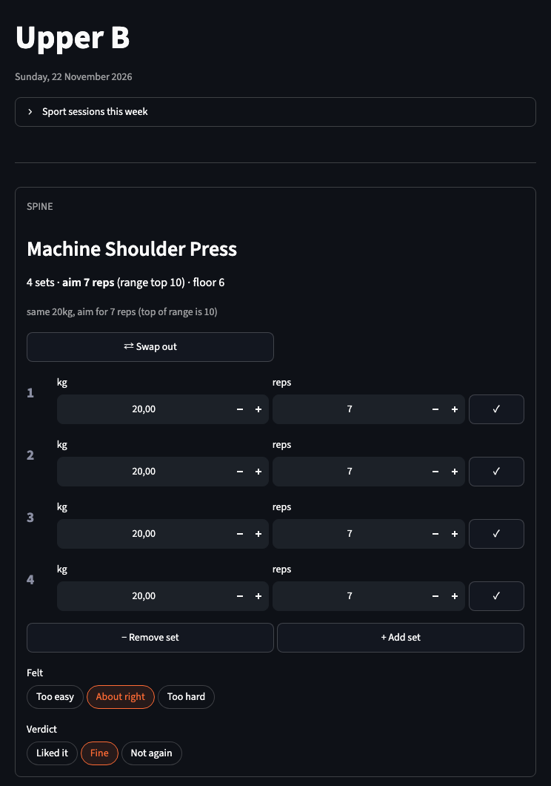

# Workout Planner

A workout assistant that recommends weight/reps from your own session
history, rotates through cards to keep things varied, and works around a
low, irregular gym frequency (built around 2-3 sessions a week, not the
4-6 most programming assumes) and a recurring commitment like team sport
training that doesn't happen on a fixed schedule.

Built for one user originally, structured so it isn't hardcoded to that
one person's preferences, see `docs/DECISION-LOG.md` for why.

Built by [Luke Harper](https://github.com/lukeharper1990-oss). The decision
log is the most interesting part: it records which design calls were reversed
after real gym sessions, and why.



## What it does

- Recommends weight and reps per exercise, derived from your own logged
  history, not a generic percentage table
- Identifies your *working* weight per session (the weight you sustained
  across sets), not just the heaviest single set
- Rotates through a small set of cards (not a rigid weekly calendar), so a
  missed session never breaks the sequence
- Flags, rather than blocks, a leg-heavy session the day before a known
  recurring commitment (e.g. a team sport session)
- Deloads after repeated stalls, ignoring sessions that were never a fair
  test (low energy, right before/after a hard external session)

See `docs/PLAN.md` for the full build plan and what's still in progress,
and `docs/ARCHITECTURE.md` for how the pieces fit together.

## Making this yours

Nothing about your gym, your exercise dislikes, or your schedule is baked
into the shared code:

1. Copy `data/users/example.json` to `data/users/<your-name>.json` and
   edit it, exclusions and equipment-access notes for your own gym
2. Create your own free Supabase project and run `docs/schema.sql` in its
   SQL editor
3. Set `SUPABASE_URL` and `SUPABASE_KEY` in `.streamlit/secrets.toml`
   locally, or in Streamlit Community Cloud's secrets manager if deploying
4. Edit `workout_app/cards.py` with your own cards, and `CommitmentSchedule` in
   `workout_app/rotation_models.py` for whatever recurring commitment
   shapes your week

## Running it

```
pip install -r requirements.txt
streamlit run streamlit_app.py
```

## Tests

```
python3 -m pytest tests/
```
