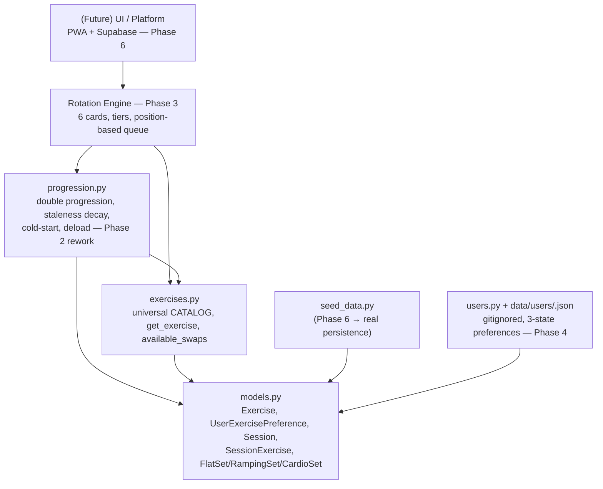

# Architecture

Prototype-first, platform-later. Everything below is pure Python with no UI
or persistence framework attached yet, by design, so the actual training
logic gets proven and tested before any platform decision locks it in.

**Source of truth**: docs/PLAN.md and docs/DECISION-LOG.md, both rewritten
12 Aug 2026 against the v3 context dump (Google Drive). Several things
below are mid-rework against that spec, not yet fully built.

## Layers

- **models.py** — universal data types only. No personal opinion lives here.
  `top_weight_kg()` has a known active bug (Phase 0 fix): it takes the max
  weight across a session's sets, misreading a heavier opener as the
  working weight instead of identifying the sustained weight.
- **exercises.py** — the shared exercise catalog (53 exercises, growing to
  reconcile against v3) and swap logic. Same catalog for every user.
- **users.py + data/users/*.json** — per-user overlay: exclusions, access
  constraints. Currently binary (excluded/not); needs a third "unsure"
  trial state per Phase 4, plus a distinction between swaps forced by
  equipment unavailability vs. swaps made by choice — only the latter
  should ever feed exclusion logic.
- **progression.py** — being reworked from a flat percentage-based model to
  double progression (weight increases only once all sets hit the top of
  a prescribed rep range), plus staleness decay and cold-start estimation,
  none of which exist yet. Equipment-aware rounding and the barbell-weight
  floor both carry over unchanged.
- **seed_data.py** — currently hardcoded real sessions. Two cards' worth of
  real data exist (Lower A, Upper B); becomes real per-user persistence in
  Phase 6, moved earlier than originally planned since browser-only
  storage already lost a full session in the source prototype.
- **Rotation Engine** — not built yet. 6 cards (not 10), alternating
  upper/lower-biased (not push/pull/legs), each with spine/primary/
  accessory tiers. Position-based queue: a missed session doesn't advance
  it and carries no penalty.
- **UI/Platform** — PWA + Supabase, an explicit recommendation from the
  source doc's own prototype testing, not just one person's phone-first
  preference. Real backend from day one, not deferred.

## Key design decisions (see docs/DECISION-LOG.md for full rationale)

- Personal preferences are a separate overlay, not baked into the shared
  catalog — required for this to ever be a real multi-user app.
- Progression respects real loadable increments (equipment-aware rounding)
  and a barbell-weight floor — both still hold under the double-progression
  rework.
- Working weight must be identified from sustained sets, not the single
  heaviest set in a session — the top-priority active bug.
- A swap's reason (unavailable vs. by choice) must be tracked explicitly,
  never inferred, or contended equipment silently reads as disliked over
  time.
